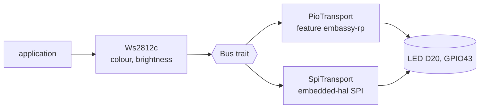

# ws2812c

Driver for the Worldsemi WS2812C-2020 RGB LED (one wire, 24 bits per LED, GRB order), the status LED D20 of the MARV V2 Rev 1 flight
controller (RP2354B). It is built on the `embedded-hal` 1.0 traits only, so it works with any executor or none. The crate root is the
async driver and the `blocking` module is the same driver for blocking buses. The driver does colour handling only; the line goes through
a `Bus` with two transports in the crate. Patterns, blinking and fading are left to the application.



## Usage

Async, PIO (feature `embassy-rp`):

```rust
let Pio { mut common, sm0, .. } = Pio::new(p.PIO1, Irqs);
let bus = ws2812c::pio::PioTransport::new(&mut common, sm0, p.PIN_43)?;
let mut led = ws2812c::Ws2812c::new(bus);
led.set_brightness(32);
led.set(ws2812c::Rgb::GREEN).await?;
```

Async, SPI:

```rust
let mut spi_cfg = embassy_rp::spi::Config::default();
spi_cfg.frequency = ws2812c::spi::SPI_NOMINAL_HZ;
let spi = Spi::new_txonly(p.SPI1, p.PIN_26, p.PIN_43, p.DMA_CH0, Irqs, spi_cfg);
let mut led = ws2812c::Ws2812c::new(ws2812c::spi::SpiTransport::new(spi));
led.set_brightness(32);
led.set(ws2812c::Rgb::GREEN).await?;
```

Blocking:

```rust
let mut led = ws2812c::blocking::Ws2812c::new(ws2812c::spi::SpiTransport::new(spi_bus));
led.set(ws2812c::Rgb::WHITE)?;
```

An LED at full level is very bright and draws about 15 mA. `set_brightness` scales every colour of the following writes; the default is
255 (no scaling). The frame pause (over 280 us) is kept by the transport; the caller never waits.

## Docs

| Page | Contents |
|---|---|
| [docs/device.md](docs/device.md) | LED timing limits, wire format, pin, measured waveforms |
| [docs/transports.md](docs/transports.md) | PIO and SPI transports, features, requirements, tests |

## Status

- Version 0.1.0. Host: `cargo test` passes; clippy, rustdoc and rustfmt are clean and every public item is documented.
- On the board: `alive` and `ws2812c_smoke` pass: every bit time is inside the datasheet limits on both transports, a dropped PIO send is
  followed by a correct frame, and every poll of `send` stays within the 50 us budget. The colours and their byte order were confirmed by
  eye with `ws2812c_colours`.
- Not done: patterns, long chains on SPI in one gapless write, DMA for long chains on PIO.

Used by: MARV-FC firmware.

## MARV project

| Repository | Role |
|---|---|
| [MARV-FC](https://github.com/Lmx154/MARV-FC) | Flight-controller firmware for the MARV V2 board (RP2350B) |
| [MARV-GCS](https://github.com/Lmx154/MARV-GCS) | Ground station (`marv-gcs`) and command line (`marv-cli`) |
| [MARV-sim](https://github.com/Lmx154/MARV-sim) | Simulator that runs the firmware's flight code |
| Sensors | [icm45686](https://github.com/Lmx154/icm45686-rs) · [lsm6dsk320x](https://github.com/Lmx154/lsm6dsk320x-rs) · [bmp581](https://github.com/Lmx154/bmp581-rs) · [bmm350](https://github.com/Lmx154/bmm350-rs) · [sam-m10q](https://github.com/Lmx154/sam-m10q) · [adc-battery](https://github.com/Lmx154/adc-battery) |
| Board I/O | [pio-sdmmc](https://github.com/Lmx154/pio-sdmmc-rs) · [qmi-psram](https://github.com/Lmx154/qmi-psram-rs) · **ws2812c** · [usb-cdc](https://github.com/Lmx154/usb-cdc) · [pio-uart](https://github.com/Lmx154/pio-uart) |
| Motors and links | [dshot](https://github.com/Lmx154/dshot-rs) · [esc-passthrough](https://github.com/Lmx154/esc-passthrough) · [rc-port](https://github.com/Lmx154/rc-port) · [crsf-codec](https://github.com/Lmx154/crsf-codec) · [mavlink-device](https://github.com/Lmx154/mavlink-device) · [marv-dialect](https://github.com/Lmx154/marv-dialect) |
| Other drivers | [lc76g](https://github.com/Lmx154/lc76g-rs) (Quectel LC76G GNSS) |

## Licence

MIT, see `LICENSE`. The driver is written from the datasheet listed in [docs/device.md](docs/device.md).
