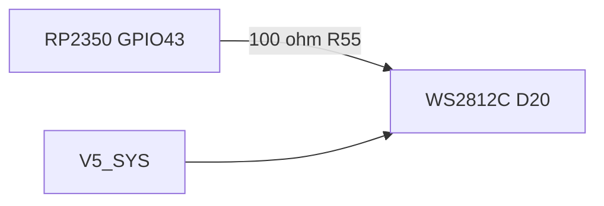

# WS2812C-2020 device facts (MARV V2 Rev 1)

Part of [ws2812c](../README.md)

One LED (D20, fitted part WS2812C-2020-V6, same pinout and pad drawing as the V1 datasheet) is the status LED. Data is on GPIO43
through a 100 ohm series resistor (R55), supplied from V5_SYS and driven by a PIO program in the GPIO16-47 window.

## Wire format

| Item | Value (datasheet p4) |
|---|---|
| Bit order | GRB, MSB first, 24 bits per LED |
| T0H | 220-380 ns |
| T1H, T0L, T1L | 580-1000 ns |
| Reset (frame pause) | low over 280 us |

SPI encoding of the driver: 0 = `1000`, 1 = `1100`, so the SPI clock must be 3.0 to 3.448 MHz (derived from the limits; nominal 3.2 MHz,
which embassy-rp rounds to 3.125 MHz).

## Waveform on the pin

The pad input reads the driven waveform from another PIO block, so the line is checked without extra hardware. Every bit time is inside
the limits on both transports.

| Transport | T0H | T1H | T0L | T1L |
|---|---|---|---|---|
| PIO on GPIO43 at 150 MHz (divider 47) | 306-320 ns | 626 ns | 940 ns | 620-633 ns |
| SPI1 (TX GPIO43, SCK on unconnected GPIO26) at 3.125 MHz, mode 1 or 3 | 320 ns | 640 ns | 953-966 ns | 633-646 ns |

- The 24 decoded bits equal the sent word.
- SPI modes 0 and 2 leave about 0.5 us between bytes and break the limits. embassy-rp's blocking SPI write waits for each byte and is not
  gapless either.
- Low time between two frames: 318-356 us (PIO), 345 us (SPI).
- Colour and byte order: GRB, as the datasheet gives (red, green, blue and white display correctly).

## Pin

All GPIO are 3.3 V logic and not 5 V tolerant.

| GPIO | Net | Function |
|---|---|---|
| 43 | LED_DATA | PIO (WS2812C), status LED D20 through 100 ohm R55 |

GPIO43 is in the GPIO16-47 PIO window. The LED and ESC PIO signals need the same window, so every PIO user shares GPIOBASE = 16.

## Code

`src/color.rs` (`Rgb`), `src/limits.rs` (datasheet limits), `src/timing.rs` (PIO timing calculation), `src/spi.rs`, `src/pio.rs`.

## Related

- [transports](transports.md): how each transport meets these limits

## Datasheet

| Device | URL |
|---|---|
| WS2812C-2020 | https://www.lcsc.com/datasheet/lcsc_datasheet_2202221130_Worldsemi-WS2812C-2020-V1_C2976072.pdf |
