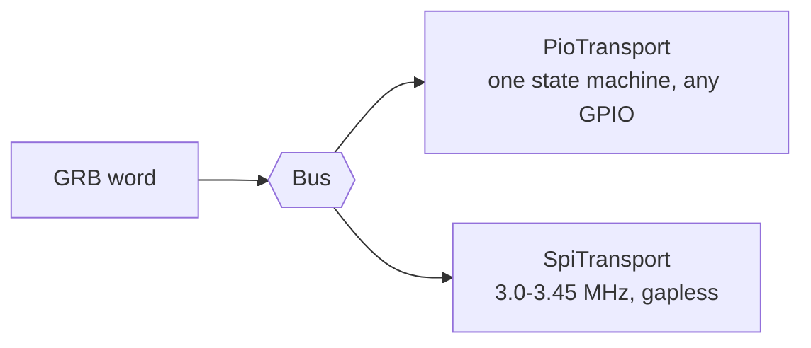

# Transports and tests

Part of [ws2812c](../README.md)

The `Bus` trait carries the 24-bit word to the LED. Two transports are included; all colour, limit and timing logic is pure code tested
on the host.



## Transports

| Transport | Requirements |
|---|---|
| `pio::PioTransport` (feature `embassy-rp`) | One PIO state machine, any GPIO, no DMA for one LED. For the Raspberry Pi RP2040/RP2350, written for `embassy-rp` 0.10 and `embassy-time`. GPIO43 is reachable only with the PIO block set to GPIO16-47, so every other state machine in that block must use pins in that range too (the SD bus does) |
| `spi::SpiTransport` | Any `embedded-hal` 1.0 or `embedded-hal-async` 1.0 SPI at 3.0 to 3.45 MHz with a gapless stream. On the RP2350 that means SPI mode 1 or 3 and the async (DMA) write; modes 0 and 2 break the timing |

No back-end for `rp2040-hal` or `rp235x-hal` exists for the PIO transport; the core and the trait are where one would go. Dependencies:
`embedded-hal` 1.0, `embedded-hal-async` 1.0, optionally `defmt`, `embassy-rp`, `embassy-time`.

## Cargo features

All off by default; without them the crate is hardware-independent `no_std`.

| Feature | Adds |
|---|---|
| `defmt` | `defmt::Format` for the public data and error types |
| `embassy-rp` | The PIO transport; the application picks the chip feature (`rp235xa` or `rp235xb`) |

## Tests

```text
cargo test                              # host
tools/run.sh alive
tools/run.sh ws2812c_smoke
tools/run.sh ws2812c_colours 600        # for a person watching the LED, about 36 s
```

`tools/run.sh` builds, flashes through a debug probe on the SWD header J10 and runs one program under a lock. Needs Rust 1.99.1 with
`thumbv8m.main-none-eabihf` and probe-rs 0.31.0. Exit status 0 means every check passed; logs go to `hil/logs/`. `hil/` is its own package
and workspace and the only place using embassy-rp. The test drives data on GPIO43; the SPI part uses SPI1 with TX on GPIO43 and SCK on
the unconnected GPIO26.

| Program | What it checks |
|---|---|
| `alive` | Tool chain, probe and board |
| `ws2812c_smoke` | The waveform on the pin for both transports against the datasheet limits, the pause between frames, the blocking front-end; red, green, blue, white for a person to watch; a PIO send dropped at each of its await points (the next frame must be right and come after a pause above 280 us); the CPU time of every poll of `send` on both transports against a 50 us budget |
| `ws2812c_colours` | Shows red, green, blue and white for 4 s each, then dark for 2 s, twice, and prints the colour and the bytes sent before each, so a person can compare the LED with the log |

Reference figures: after a dropped PIO send the pause before the next frame is 316 to 674 us; the longest single poll of `send` over 128
sends is 20 to 25 us (median 2.4 us on PIO, 20 us on SPI); the very first send takes longer in one poll (37-39 us PIO, 65-68 us SPI) and is
reported, not held to the budget.

## Related

- [device](device.md): the limits these checks use
